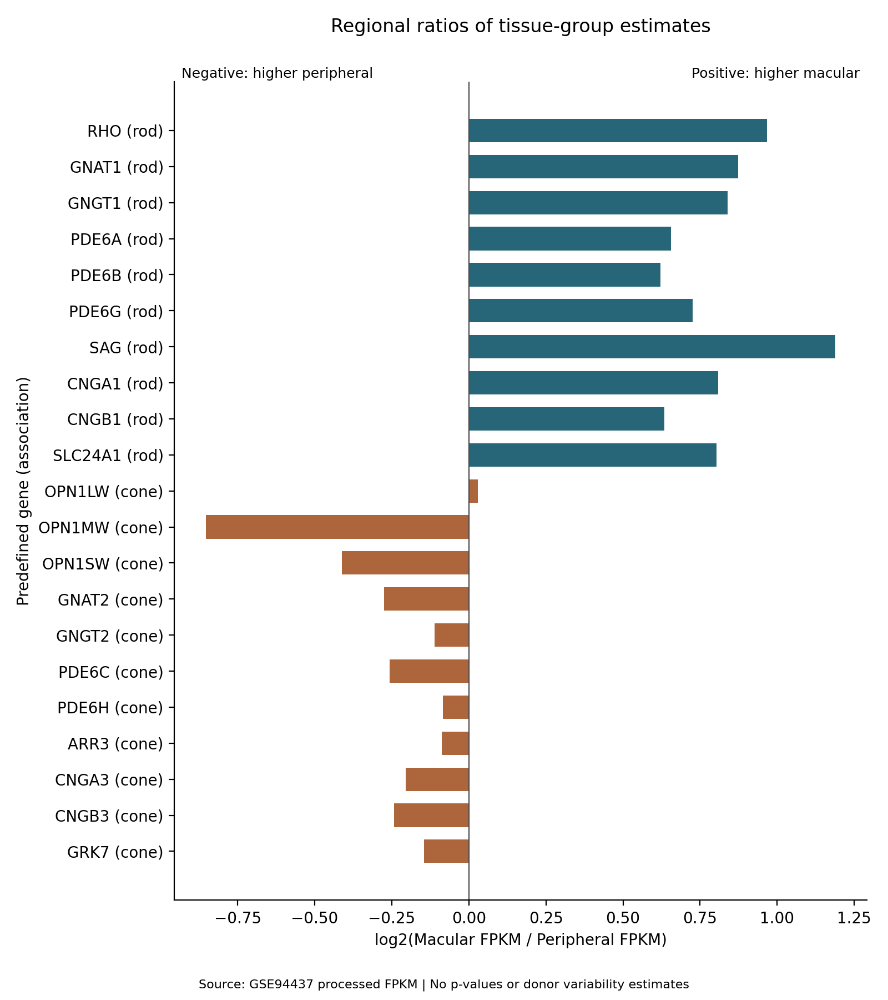
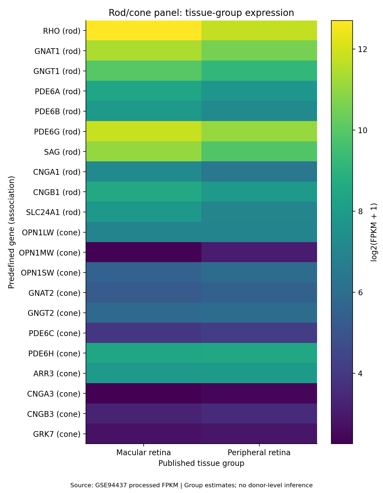

# Rod/cone-associated expression across human retinal regions

An undergraduate computational biology project using real processed data from [NCBI GEO GSE94437](https://www.ncbi.nlm.nih.gov/geo/query/acc.cgi?acc=GSE94437).

**Question:** What patterns do predefined rod- and cone-associated genes show in published macular versus peripheral retina tissue-group FPKM estimates?

**Scope:** This is an exploratory, descriptive comparison of two tissue-group estimates. The original study has 16 retinal sample records representing eight eye-level pairs, but the available processed file does not provide their individual expression measurements. No paired tests, p-values, FDR, sample PCA or donor-level claims are made. The former paired-analysis proposal has been revised; see the [Chinese revision draft](docs/revised-proposal.zh.md).

## Completed version 1.0

The local exploratory analysis, raw-to-results verification, two figures, full marker output and a six-page English research report are complete. Read the [report](output/pdf/retina_exploratory_report.pdf), [source-context audit](docs/source-context.md) and [Chinese completion guide](docs/project-status.zh.md). No independent expression dataset or new experiment was used. This is a secondary-analysis portfolio project, not a claim of novel or statistically validated biology. Documentation and code were prepared with AI assistance and should be reviewed and understood before academic submission.

## Findings

All 21 predefined markers match uniquely and have OK status in both retina groups. All 10 rod-associated markers have higher macular group estimates. Of 11 cone-associated markers, 10 have higher peripheral estimates; OPN1LW has a slightly higher macular estimate. This pattern does not support the initially expected regional directions at the level of these published group values. It does not establish a statistically reliable reversal in individual donors or a difference in cell abundance.



Positive values indicate higher macular FPKM; negative values indicate higher peripheral FPKM. Each bar is a different gene, not a biological replicate. No uncertainty intervals for the regional contrast can be inferred from this input.



Shared color scale: log2(FPKM + 1). This is expression magnitude, not a cell-type abundance score.

## Reproduce

The current analysis was tested with Python 3.14.0 and the versions in requirements-exploratory.txt. The older requirements.txt is retained for the former paired workflow. Keep the original GSE94437_genes.fpkm_tracking.gz and GSE94437_series_matrix.txt.gz in data/raw/ (excluded from Git).

```bash
python3 -m venv .venv
source .venv/bin/activate
python -m pip install -r requirements-exploratory.txt
python scripts/audit_geo.py --download
python scripts/prepare_uploaded_retina.py
python scripts/explore_groups.py
python scripts/verify_exploratory.py
```

The audit uses Python's standard library. The plotting step requires numpy and matplotlib. The previously developed paired workflow additionally uses pandas and scipy.

## Research deliverables (v1.0)

- [Six-page research report](output/pdf/retina_exploratory_report.pdf): English report with methods, figures, discussion and references.
- [Source context and evidence boundaries](docs/source-context.md): literature checks and unresolved provenance questions.
- [Independent verification](results/exploratory/verification.json): raw-to-cleaned checks and explicitly post-hoc sensitivity results.
- [Chinese project status](docs/project-status.zh.md): completion criteria and how to explain the work.

The independent verification passes for all retained source fields and all 21 marker measurements. Removing the three opsins leaves eight cone-associated genes, all higher in the peripheral estimate. These checks do not establish statistical significance or independently validate the original tissue labels.

The broad macular sample should not be equated with the foveal center. The [source paper](https://doi.org/10.1093/hmg/ddu114) discusses sampling and anatomical heterogeneity; see the report for interpretation. A deposited Ensembl-versus-published RefSeq annotation difference remains unresolved, so this project does not claim exact replication of the paper's quantitative findings.

To rebuild the PDF, install requirements-report.txt and run `python scripts/build_report.py` after the analysis. The report is an AI-assisted project draft for author review, not a peer-reviewed publication. Analysis and figure generation were rerun locally; a separate clean-machine installation has not been tested.

## Files to read

- [Beginner guide](docs/exploratory-guide.zh.md): how to read the results and figures.
- [Methods](docs/methods.md): matching, transformations and limitations.
- [Results](results/exploratory/summary.md): observations and concrete examples.
- [Marker results](results/exploratory/marker_expression.csv): full 21-gene output with match/QC fields.
- [Retinal group expression](data/retinal_group_expression.csv): both retinal groups with source bounds and status.
- [Metadata](data/metadata.csv): sample identity and pairing, not an expression matrix.
- [Marker panel](data/gene_sets.csv): frozen marker rationale and literature references.
- [Upload audit](results/upload_inspection.json): actual uploaded file structure and checksum.

## Verification and sensitivity

All retained fields were compared against the original gzip, and all 21 gene values and log ratios were independently recalculated. Sample titles and tissue-characteristic labels agree. Excluding the three opsins leaves eight cone-associated genes, all with higher peripheral group estimates. Four full-panel ratios fall inside the illustrative post-hoc band 1/1.1 to 1.1: OPN1LW, GNGT2, PDE6H and ARR3. This band is not a significance or equivalence test. See [verification outputs](results/exploratory/verification.json).

To rebuild the PDF, additionally install requirements-report.txt and run `python3 scripts/build_report.py`. To create a local upload bundle, run `python3 scripts/package_project.py`. Raw downloads and temporary renderings are not included in the bundle; the README explains how to fetch the inputs.

## Limitations

Two group estimates cannot reveal donor variability or support donor-level hypothesis tests. Bulk tissue expression mixes cell composition and within-cell expression. Original normalization and mapping can influence FPKM ratios. Near-equal ratios should not be overinterpreted. Source confidence bounds are preserved in the full table but are not donor replicates or confidence intervals for the regional ratio. The marker panel is not changed to fit observed results.

The previous sample-level workflow, scripts/analyze.py, is retained for a future verified 16-sample FPKM input and is not used for these findings. Its former methods are archived in docs/archive/paired-methods.md.

## Source study

Li M, Jia C, Kazmierkiewicz KL, et al. *Comprehensive analysis of gene expression in human retina and supporting tissues*. Human Molecular Genetics. 2014;23(15):4001–4014. [doi:10.1093/hmg/ddu114](https://doi.org/10.1093/hmg/ddu114).
